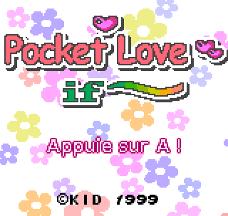

# Pocket Love ~if~ — traduction française

**Pocket Love ~if~** (Neo Geo Pocket Color, KID, 1999), entièrement en français : tout le
script (plus de 10 000 messages), menus, planning, stats, boutique, téléphone, rendez-vous,
sauvegardes, saisie du nom, écran titre avec logo latin, et générique.

<p align="center">
  
  
</p>

- **Partie 1 (français)** : jouer en français — le patch et comment l'appliquer.
- **Part 2 (English)** : the translation kit — tools and guide to translate the game into another language.

---

# Partie 1 — Jouer en français

## 1.1 Ce qu'il vous faut

Le patch : `patch/Pocket_Love_if_FR_v1.0.ips`.

**Votre propre** copie de la cartouche **japonaise**, non modifiée et sans en-tête. Aucune ROM
n'est fournie ici. Vérifiez-la :

| | ROM d'origine attendue |
|---|---|
| Nom (par exemple) | `Pocket Love - if (Japan).ngc` |
| Taille | 2 097 152 octets |
| CRC32 | `C2EE1EE5` |
| MD5 | `62347264d918559a95034be7cea8756d` |
| SHA-1 | `2b5d9628b7b5911f90c28321227d47a527a719ea` |

Avec une autre ROM (déjà modifiée, autre dump), le patch donnera un jeu cassé.

## 1.2 Méthode A — patch appliqué à la volée par l'émulateur

L'émulateur applique le patch en mémoire à chaque lancement : la ROM d'origine n'est **pas
modifiée**. Posez le fichier `.ips` à côté de la ROM, **sous le même nom**, puis lancez la ROM
japonaise normalement :

```
Pocket Love - if (Japan).ngc
Pocket Love - if (Japan).ips
```

Ce patch **agrandit** la ROM (2 Mio → 4 Mio). L'application à la volée n'a pas été testée pour
cette version : en cas de souci, utilisez la méthode B.

## 1.3 Méthode B — créer une ROM française (console, ou tout autre émulateur)

Fabriquez une fois pour toutes une ROM patchée :

- avec un outil IPS courant : **Rom Patcher JS** (dans le navigateur), **Flips** ou **Lunar IPS** ;
  choisissez la ROM japonaise, puis le `.ips`, et enregistrez le résultat ;
- ou avec l'outil fourni (Python 3) :

  ```
  python tools/ips.py apply "Pocket Love - if (Japan).ngc" patch/Pocket_Love_if_FR_v1.0.ips Pocket_Love_if_FR.ngc
  ```

La ROM obtenue doit avoir ces empreintes, quel que soit l'outil :

| | ROM française obtenue |
|---|---|
| Taille | 4 194 304 octets |
| CRC32 | `6274E817` |
| SHA-1 | `65829d9f21ae794195ff5c1379829ddb0fe75132` |

## 1.4 Ce qui a été vérifié, ce qui ne l'a pas été (v1.0)

Vérifié à l'émulateur : écran titre et menu, saisie du nom, début du jeu (réveil, cérémonie
d'entrée, réunion de classe, comparé image par image à la version japonaise), planning de la
semaine et du week-end, stats, sorties et carte, boutique et achats, téléphone (invitation, refus,
accord, choix du jour, du moment et du lieu, récapitulatif), jour du rendez-vous (tenue, parfum,
inspection, café), sauvegarde, une fin (Mirei) et tout le générique.

Pas encore contrôlé à l'écran (un retour est bienvenu si un texte déborde ou se coupe) : la plupart
des milliers d'événements aléatoires du script, les autres fins, le photomaton et l'album.
La ROM n'a pas encore été essayée sur une vraie console.

Les grilles de kanji du clavier de saisie restent en japonais (onglet « JP ») : c'est voulu.

## 1.5 Choix de traduction

- Traduit depuis le **japonais**, en adaptant plutôt qu'au mot à mot : chaque réplique doit avoir
  du sens dite par ce personnage. Le ton d'origine est respecté, y compris quand il est cru.
- Les termes d'adresse japonais connus sont gardés (**-kun**, **-san**, **-chan**, **-senpai**,
  **-sensei**, **onee-chan**…), tout le reste est traduit. Les anglicismes des personnages sont
  gardés (« darling » de Mirei, « Gouuud mooorning » de Momoyo), comme les tics de langage
  (Momoyo parle d'elle à la 3e personne, « nya »).
- Entre lycéens, on se **tutoie** (le japonais poli ne passe pas bien en vouvoiement) ; le
  vouvoiement reste pour le pluriel et les adultes.
- Dates à la française (jour/mois), jours de la semaine en une lettre (L M M J V S D), ¥ pour les
  yens.
- Écran titre : logo « Pocket Love » redessiné en lettres latines.

## 1.6 Crédits

- **Traduction française, police latine, logo, outils** : **Tixul**, sous **licence MIT**
  (fichier `LICENSE`) pour les outils et les fichiers de traduction.
- *Pocket Love ~if~* © 1999 KID. Ce projet de fans n'est ni affilié ni approuvé par les ayants
  droit. Il ne contient **ni ROM, ni BIOS, ni texte d'origine** : le patch ne contient que des
  octets modifiés, et le script japonais n'est obtenu qu'en l'extrayant de sa propre ROM.

---

# Part 2 — Translation kit (English)

Everything needed to translate the game into **another Latin-alphabet language**. You edit text
files; the tools rebuild the ROM (text relocation into the second chip, variable-width font,
hooks, graphics) and refuse to build while a rule is broken.

| Folder / file | Content |
|---|---|
| `lang/fr/` | the French translation (text files) and its glossary — use it as your template |
| `tools/` | build the translated ROM and the IPS patch |
| `tools/asm/` | sources of the two small routines added to the game (assembled with AS, `cpu 96C141`) |
| `patch/` | the released French patch |
| `screenshots/` | the two screenshots shown at the top of this file |
| `FORMAT.md` | technical notes on the ROM: archive, encoding, font, hooks, limits (in French) |

## 2.1 Requirements
- Python 3.9 or later, and **Pillow** (`pip install pillow`).
- The original **Japanese ROM** (hashes in section 1.1). The tools check it and refuse any other file.
- The Windows fonts used to draw the new glyphs and title graphics (not included):
  `msgothic.ttc` (MS Gothic, the game's own font), `verdana.ttf` (title-menu words) and
  `comicbd.ttf` (title logo). On another system, edit the `POLICE…` paths at the top of
  `tools/police_fr.py`, `tools/titre_fr.py` and `tools/logo.py`.

## 2.2 Steps
1. **Extract the Japanese script** from *your own* ROM (it is not distributed):
   ```
   python tools/extract.py "Pocket Love - if (Japan).ngc"
   ```
   This writes `out/ja_script.txt`, `out/ja_interface.txt` and `out/ja_dico.txt`: one line per
   message, `NNNNN text`.
2. **Copy** `lang/fr` to `lang/<code>` (e.g. `lang/es`) and translate the files (rules below).
3. **Check, then build** the ROM and the patch, and test in an emulator:
   ```
   python tools/build.py --rom JP.ngc --lang <code> --verif
   python tools/build.py --rom JP.ngc --lang <code> --ips
   ```
   Output: `out/<code>.ngc` and `out/<code>.ips` (a patch for the **Japanese** ROM).
   ⚠️ Distribute the **.ips** only, never the ROM.

## 2.3 File formats and rules

Every `*.txt` file in `lang/<code>/` is read; `;` starts a comment line. One line per message:

| Line | Meaning |
|---|---|
| `@NNNNN<TAB>text` | script message n° NNNNN (entry 10) |
| `#NNNN<TAB>text` | interface message n° NNNN (entry 11) |
| `%NN<TAB>text` | dictionary word `{E0x}` (entry 9) |

A message with no line keeps its Japanese text. Tags:
- `|` or `{n}` new line, `{attente}` wait for a key, `{page}` new box, `{fin}` end (**mandatory**).
- `{E00}`..`{E0A}` dictionary words (girls' names, `...`); `...` is turned into `{E03}` automatically.
- `{F00}` surname, `{F01}` first name, `{F02}` nickname, `{F03}`..`{F08}` the way Ruruna, Mizuki,
  Yumi, Momoyo, Mirei and Konoha call the hero: inserted by the game, keep them.
- `{F09}` / `{F0B}` colour on / off; `{>N}` pad to column N pixels (menus, aligned columns);
  `{XYZ}` raw hexadecimal code.

Limits, checked by `build.py --verif` (all errors are listed at once):
- **144 px** per line, **136 px** on the 4th line of a box, **4 lines** per box,
  **128 codes** per message. Measure a line with `python tools/mesure.py "line 1|line 2"`.
- In a few phone-call windows the lower lines are cut around **130 px**; place names in the date
  list must stay under ~130 px.
- Characters available out of the box: `a-z A-Z 0-9`, `é è ê ë à â ä î ï ô ö û ù ü ç œ æ`,
  `É È Ê Ë À Â Î Ï Ô Û Ù Ç Œ`, `. , ; : ! ? ' " - ( ) / % & + = * # « »`, plus the game's own
  `~ ♥ ♪ … 「 」`. Add yours to `CARS` in `tools/police_fr.py` (free font slots remain).

Language-specific graphics live in the tools (edit them for your language):
`tools/titre_fr.py` (`LETTRAGES`: title-menu words), `tools/logo.py` (`MISE_EN_PAGE`: title logo),
`tools/hud_fr.py` (one-letter weekdays, ¥), `tools/planning_fr.py` (planning labels and hints),
`tools/stats_fr.py` (stat names), `tools/clavier_fr.py` (name-entry tabs), `tools/date_fr.py`
(day/month order of the date phrases).

`build.py --identite` rebuilds the text entries without any translation and checks they are
byte-for-byte identical to the original.

## 2.4 Credits and legal
- French translation, Latin font, logo and tools: **Tixul**, released under the **MIT License**
  (see `LICENSE`).
- *Pocket Love ~if~* © 1999 KID. This fan project is not affiliated with or endorsed by the
  rights holders. It contains **no ROM, no BIOS and no original game text**; the Japanese script
  is only obtained by extracting it from your own ROM.
